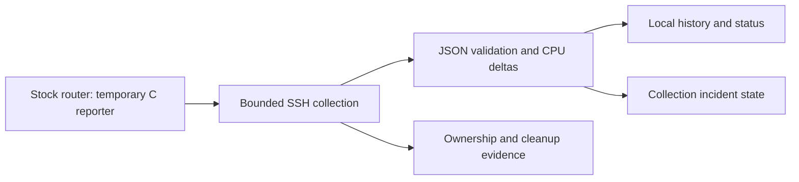

# ASUS Router Telemetry

[](https://github.com/markpierotti/asus-router-telemetry/actions/workflows/offline-tests.yml)

**Custom ARM telemetry on stock firmware, with supervised hardware tests for collection, link loss and recovery.**

A small C reporter runs temporarily on an ASUS RT-AX56U. A Python standard-library
collector on an external host verifies the transferred executable, validates its
JSON, derives CPU utilisation and records collection incidents. Routine collection
makes **zero model calls**.

The project combines firmware analysis, cross-compilation, process handling,
defensive parsing and physical-device validation. Mark Pierotti directed the work
with Hermes and AI coding agents; [provenance](docs/provenance.md) explains the
human contribution, assisted implementation and independent verification.

## Part of a larger home lab

This is the first completed component of Mark Pierotti’s planned home networking
and security lab: collecting bounded, validated device telemetry and preserving
evidence when a management connection fails. Next stages will explore Linux-hosted
collection, network segmentation, traffic visibility and detection engineering.
The [home-lab roadmap](docs/home-lab-roadmap.md) separates this released milestone
from the planned work, including Project Limbo and security-operations exercises.

## Measured results

Current accepted bench pair: **collector 1.5.5 / reporter 1.0.5**, on stock
firmware 3.0.0.4.386_45898 and Linux 4.1.52 armv7l.

| Trial | Observed result |
| --- | --- |
| Supervised healthy path | 14 successful samples: two one-shots, an 11-sample loop and a post-stop one-shot |
| Steady loop collection | 0.179–0.201 seconds per attempt; sample spacing 59.9962–60.0050 seconds |
| Host-side Ethernet dropout | 18 attempts: 12 successful samples and six expected unreachable outcomes |
| Incident transitions | Opened after three consecutive failures; resolved after two recovery successes |
| Stop and restart | Ctrl-C exited 130; post-stop collection exited 0 |
| Cleanup after link loss | One stranded owned directory recorded, manually removed and checked absent through a separate SSH connection |

The steady timings describe an isolated, lightly loaded bench trial. They are not
measurements of the reporter's CPU overhead or a guarantee under network/NAS load.
Hardware acceptance applies to the named artifact and private bench adaptation;
this portable configuration was tested offline.

Read the [case study](docs/case-study.md), [healthy-path record](docs/healthy-acceptance-20261014.md)
and [dropout/recovery record](docs/dropout-recovery-20261014.md). The
[sanitized numeric summary](evidence/dropout-summary-20261014.json) exposes the
trial counts and conclusions without publishing target access details.

## How it works



The collector checks pinned host identity and artifact hashes, creates an exclusive
temporary directory, proves its watchdog can terminate a long job, and bounds
execution and received output. Cleanup uncertainty survives later successful
collection. An unreachable management address is reported as a collection failure;
it does not establish that the router itself is down.

Review-driven regression tests cover malformed and oversized data, numeric limits,
terminal password input, process interruption, lost SSH masters, retention and
cleanup ownership. [Design notes](docs/design.md) explain the contracts and limits;
the [validation record](docs/validation.md) preserves review and version history.

## Try offline

Requires a C compiler, Make and Python 3.11+ on macOS or another POSIX host.
From the repository root:

```sh
make test
./out/router_health --pretty
demo_dir="$(mktemp -d /tmp/router-telemetry-demo.XXXXXX)"
python3 collector/collector.py collect --once --transport mock --data-dir "$demo_dir"
python3 collector/collector.py status --transport mock --data-dir "$demo_dir"
```

Keep the printed mock results in that disposable directory for inspection. The test
suite and mock transport contact no router. Native macOS checks exercise parsing,
JSON and process handling; actual Linux `/proc` telemetry requires Linux. Run the
suite serially; the [collector instructions](collector/README.md) explain terminal
requirements and environment-dependent test limitations.

## Build and live use

`sh build-arm.sh` requires Docker with linux/amd64 support. The base image is pinned
by digest, but apt packages are not pinned, so future bit-for-bit rebuilds are not
guaranteed. Build records and QEMU checks are distinct from hardware acceptance of
the historical executable.

For live use, follow the [collector configuration instructions](collector/README.md)
and supply your own target, trusted host keys and artifact hashes. No live target
is configured by default. Collection uploads and executes a temporary userspace
program; it does not flash firmware or install persistent software.

## Scope and publication

Multi-hour reliability, unattended authentication, power-loss/reboot recovery,
AP operation and USB NAS performance remain unvalidated. The collector is a
foreground tool, with no scheduled service, alerts or automatic remediation. This
milestone does not establish a deployed SOC or whole-network traffic visibility.

Credentials, actual host keys, private configuration, raw history, vendor firmware
and extracted proprietary binaries are excluded. Local agent worktrees are ignored.
Earlier hardware records retain their original version boundaries.

**License:** [MIT](LICENSE), copyright 2026 Mark Pierotti. Third-party tools and
vendor firmware are not distributed. See [SECURITY.md](SECURITY.md) for security
boundaries and reporting guidance. [Release versioning](docs/releases.md) separates
project milestones from collector and reporter versions.
