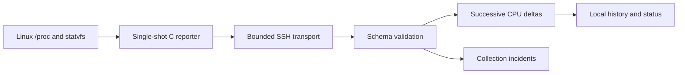

# Design and engineering tradeoffs

## Lightweight router component

The C reporter opens no listener and exits after one JSON document. A static ARMv7 build avoids needing the router's exact dynamic loader, while still depending on its kernel and instruction support. This is userspace software, not replacement firmware. Filesystem capacity uses statvfs; `/proc` parsing supports fixture input.

Mount paths decode octal escapes such as `\040` before capacity lookup. Schema 2 excludes virtual placeholder mounts and duplicate records; unavailable memory and inode values remain null. Candidate storage uses path/device heuristics and does not establish physical USB identity.

## External collection

The collector makes no model calls. It verifies local inputs, uses strict SSH host-key checking and a shared session, creates an exclusive owned `/tmp` directory, self-tests its remote watchdog, verifies transferred bytes, and runs the reporter with a bound. Directory cleanup failures are surfaced separately. Interactive SSH needs both a controlling terminal and foreground process-group ownership; restoring terminal modes and cleaning descendants were explicit regression cases.

The ssh option set is hermetic: ambient configuration is ignored (`-F /dev/null`), the system-wide known-hosts file is disabled, and agent/forwarding/proxy settings are pinned off, so the connection cannot be altered by a `~/.ssh/config` stanza. Every multiplexed command first asks the control master — through `ssh -O check` — whether it is still alive; a lost master becomes an explicit `control_master_lost` failure instead of a silent fallback to a fresh direct connection that would need interactive authentication. Master shutdown is checked with a follow-up local `-O check`; its verdict describes the control socket, not independent proof of process exit. It is never inferred merely from the absence of an error, and the result is a distinct fact rather than a boolean: confirmed exit, still answering, probe that could not complete, or no master to stop. An unconfirmed shutdown is persisted as a `teardown` record and makes the run exit non-zero **without** masking the original collection failure. The success diagnostic is read from **stderr as well as stdout**, which is where real OpenSSH writes `Master running (pid=N)`. `SIGHUP` and `SIGTERM` reach the same orderly teardown as Ctrl-C in both modes, and the handlers stay installed **through** the teardown, so a second signal lands in the same orderly path instead of killing the process mid-cleanup.

Remote state is recorded rather than assumed. Ownership of the remote directory is a tri-state — `none`, `unknown`, `owned` — and appears in every attempt record; `unknown` means the `mkdir` was sent but never acknowledged, so a directory *may* exist. A directory is removed only when ownership was acknowledged, and the removal must print its own marker. A cleanup that cannot be confirmed adds a `teardown` record to the append-only outcome log and an entry to `pending_cleanup.jsonl`, which names the exact path for a later read-only reconciliation. Nothing deletes an uncertain directory automatically, and **no process is signalled at all**. An earlier revision killed the PID OpenSSH reported; a PID alone carries no executable, owner or start-identity evidence and can be reused by an unrelated process, so the fallback was removed rather than hardened. A master that will not exit is therefore left running, and that cost is *reported* instead of a foreign process being killed. `ControlPersist` is an **idle** timeout: it ends a master that has had no client for that long, and is not a deadline by which a stuck or still-busy master is guaranteed to be gone.

Device output is drained under explicit byte ceilings while it is received, and the parser enforces a size and nesting budget, so an authenticated-but-hostile endpoint cannot exhaust host memory or stop the loop with a decoder failure. Untrusted device text is bounded and stripped of control bytes by a single sanitiser before it can reach a terminal or an outcome record, so it can neither spoof terminal lines nor fill the outcome log. Provisioning gates are hard stops: the required-tool probe and the watchdog self-test must each present unambiguous positive evidence. The gates that can stop before any remote state exists are the known-answer test and the tool probe; the watchdog self-test, the transfer and the control execution run **after** the exclusive directory has been created, and their failures trigger the ownership-scoped cleanup described above.

Provisioning facts survive whatever ended the provisioning phase. The transport
attaches the remote directory, the tri-state ownership and the cleanup outcome to the
exception it raises, and the collector folds them into the attempt record for **every**
error class — a lost control master, an artifact mismatch, an output-ceiling breach, a
local storage failure — not only for a provisioning error. The outcome *classification*
is preserved; only the cleanup and ownership evidence is taken from the exception. A
provisioning failure that did reconcile its own directory still records
`cleanup_ok: true` and queues nothing.

That rule is enforced by *where* the facts are read, not by each classifier branch
remembering them. The exception a failed `start()` raises is kept at the single point
it enters the collector, before classification, so a branch can neither drop the facts
nor be added without them — which is how `unreachable`, the timeout and the
authentication classes had lost them. A failure with no facts attached changes
nothing, so a live session's ownership is never replaced by a default. A
*cancellation* that leaves `start()` carries the same facts; it is not classified and
has no attempt record, so they are written to the `teardown` record and the
pending-cleanup log instead.

Teardown is cancellation-safe. A `BaseException` raised while the remote directory is
being removed (Ctrl-C, `SIGTERM`, `SIGHUP` during cleanup) is recorded as UNCERTAIN
removal and then re-raised, so the operator's intent is honoured and the uncertainty is
not thrown away with it. The teardown record is written from a `finally`, and the
data-directory lock is released from its own independent `finally`, so neither the
evidence nor the lock depends on the teardown completing. An interrupt during teardown
keeps the interrupted exit status; it is never turned into success.

The same holds for the last step, stopping the control master. A cancellation during
`ssh -O exit` or the follow-up `-O check` is *held* for one bounded check, the verdict
is recorded, the local control-socket directory is released, and only then is it
re-raised; nothing is retried. "Teardown was interrupted" is not one fact, so the
cancellation carries the stage: an interrupt during the removal leaves the directory
unconfirmed, an interrupt during the master exit after a confirmed removal leaves no
directory to reconcile, and a removal that had already failed keeps its own reason.
When the teardown being cancelled belongs to an attempt that has already been
classified, the cancellation is also held for the one local write that records that
attempt, so the failure it interrupted is not lost with it.

Classification is contained. A device reply the collector cannot tokenise, an unbounded numeric marker, a missing `ssh` binary, an unreadable artifact or a damaged `state.json` all become recorded, classified outcomes; a damaged `state.json` is quarantined rather than silently reset. A failure to write evidence is reported through `persistence_error` and a non-zero exit, never assumed to have succeeded.

Local history is bounded by record count and by byte budget, files are created `0600` and directories `0700`, writes are `fsync`ed, a torn trailing line is terminated before the next append, and `prune` takes the same lock as collection.

Raw CPU counters require two readings. Idle includes iowait; guest time is not added twice. First readings, resets and detected reboots have explicit states; a counter reset is judged per field except the idle group, which is judged as a sum, because a tickless kernel can reclassify time between `idle` and `iowait`. Reboot detection prefers the **explicit boot identity** — `host.boot_time`, read from `/proc/stat`'s `btime` — and falls back to a documented heuristic (uptime moving backwards, then a wall-clock estimate of the boot instant) only when a sample does not carry one. The previous sample is located through recorded state, not by filename order, and must carry the same source.

Persisted monotonic values should not be compared across a collector-host reboot or across hosts. Samples from different devices or mock/live sources must use separate data directories.

## Operational boundaries

Three consecutive collection failures open a local incident; two successes resolve it. SSH failure does not establish a router outage. A pinned host-key or artifact-gate failure is a **hard stop**: the loop ends instead of retrying an endpoint whose identity is not established. Retention limits record counts. The loop is foreground only, with no scheduled service, notifications or automatic remediation, and it refuses an interval that is non-finite, below one second or at/above `ControlPersist`. Password authentication is the current transport setting; public-key authentication is explicitly disabled, so unattended use needs an implementation change and not merely a key in `authorized_keys`.

The latest supervised hardware trial additionally establishes collection-incident opening and resolution through one Ethernet cable loss, operator-authenticated recovery and manual reconciliation of one stranded directory. It does not establish unattended or long-term reliability, all network failure conditions, AP/NAS operation or a security-hardened network. Heavy analysis remains a separate external-host concern.
