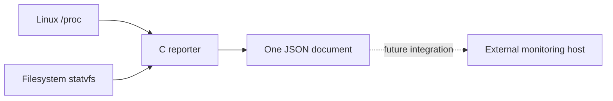

# Design and engineering tradeoffs

## Collection flow

The reporter has no networking component. External invocation and transport belong to a separate integration layer.

## Why C and static ARM

C provides direct access to system interfaces with a small single executable. The ARM build uses `arm-linux-gnueabi-gcc`, ARMv7-A instructions and static linkage. This avoids requiring the router's installed dynamic loader or matching glibc symbol versions. Static linkage still depends on the running kernel, supported instructions and execution environment; it is not a universal compatibility guarantee.

## Mount-path failure

`/proc/mounts` escapes spaces as `\040`. Passing an encoded mount path directly to `statvfs` returns an error for a real path such as `/tmp/mnt/My Disk`. The implementation decodes octal escapes before looking up capacity. Embedded tests cover the decoder; a real tmpfs mount with a space was also used in the recorded offline validation.

## Bounded collection

Reads and generated CPU-counter storage have explicit limits. Embedded tests cover escaping and CPU output truncation. These checks are not an exhaustive audit, and missing/truncated inputs must not be treated as a clean bill of health.

## Deliberate limits

- Raw counters do not directly provide CPU utilization percentages.
- Mount heuristics can include candidate storage that is not a real attached USB disk.
- A single successful run will not demonstrate long-term reliability or startup persistence.
- macOS smoke tests establish parser/JSON behavior, not Linux `/proc` collection.
- The captured live device inventory does not establish the userspace floating-point ABI.
- Heavy security analysis belongs on a more capable external host; this project focuses on lightweight collection.
