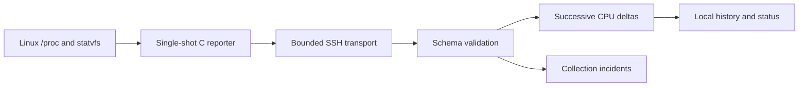

# Design and engineering tradeoffs

## Lightweight router component

The C reporter opens no listener and exits after one JSON document. A static ARMv7 build avoids needing the router's exact dynamic loader, while still depending on its kernel and instruction support. This is userspace software, not replacement firmware. Filesystem capacity uses statvfs; `/proc` parsing supports fixture input.

Mount paths decode octal escapes such as `\040` before capacity lookup. Schema 2 excludes virtual placeholder mounts and duplicate records; unavailable memory and inode values remain null. Candidate storage uses path/device heuristics and does not establish physical USB identity.

## External collection

The collector makes no model calls. It verifies local inputs, uses strict SSH host-key checking and a shared session, creates an exclusive owned `/tmp` directory, self-tests its remote watchdog, verifies transferred bytes, and runs the reporter with a bound. Directory cleanup failures are surfaced separately. Interactive SSH needs both a controlling terminal and foreground process-group ownership; restoring terminal modes and cleaning descendants were explicit regression cases.

Device output is drained under explicit byte ceilings while it is received, and the parser enforces a size and nesting budget, so an authenticated-but-hostile endpoint cannot exhaust host memory or stop the loop with a decoder failure. Provisioning gates are hard stops: the required-tool probe and the watchdog self-test must each present unambiguous positive evidence, and a failure stops the run before any remote state is created. Local history is bounded by record count and by byte budget, and `prune` takes the same lock as collection.

Raw CPU counters require two readings. Idle includes iowait; guest time is not added twice. First readings, resets and detected reboots have explicit states. Falling uptime detects some reboots but is not a boot identity. Persisted monotonic values should not be compared across a collector-host reboot or across hosts. Samples from different devices or mock/live sources must use separate data directories.

## Operational boundaries

Three consecutive collection failures open a local incident; two successes resolve it. SSH failure does not establish a router outage. Retention limits record counts. The loop is foreground only, with no scheduled service, notifications or automatic remediation. Password authentication is the current transport setting; unattended key use needs a separate change.

Two successful hardware samples establish the measured path, not long-term reliability, safe failure handling under every real network condition, AP/NAS operation or a security-hardened network. Heavy analysis remains a separate external-host concern.
